<p align="center">
  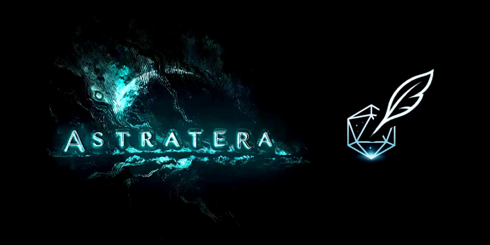
</p>

<h1 align="center">Astratera Kurator</h1>

<p align="center">
  A desktop session manager for running a long, prep-heavy tabletop campaign.<br>
  Prepare places, people, scenes and dialogue once, then run the session from one narrow, fast, dark window.
</p>

---

Kurator is built for a game master who preps in a notes tool (Notion, or Astratera Kodex) and needs something quicker than a wiki **at the table**. It keeps the read-aloud text, the NPCs who are present, the open plot threads and the dice checks for the place and moment you are in, and nothing else.

It was written for a sci-fi D&D campaign, but nothing in it is tied to one setting. Everything is stored as plain JSON on your own machine. There is no account, no cloud and no telemetry.

All screenshots in this document use the small example campaign that ships with the app.

## Contents

- [The idea in one minute](#the-idea-in-one-minute)
- [Play mode](#play-mode)
- [Create mode](#create-mode)
- [Quests](#quests)
- [Travel encounters](#travel-encounters)
- [Astratera Kodex integration](#astratera-kodex-integration)
- [Campaigns, backups and moving content](#campaigns-backups-and-moving-content)
- [Other integrations](#other-integrations)
- [Keyboard shortcuts](#keyboard-shortcuts)
- [Install and run](#install-and-run)
- [Project layout and development](#project-layout-and-development)

---

## The idea in one minute

Content is not a fixed tree of "chapter → location → day". Everything you write is a **content module** (a description, a note, a dialogue topic, a trackable section, a scripted scene) that is **assigned** to an entity (an NPC, a location or a quest) and, if you like, to a point in time.

- **Time** is a free sequence of **milestones** (checkpoints) on one campaign clock, for example "Day 1 · dawn". Pick any granularity you want.
- **Presence** says who is at a location at a given milestone. **Mentions** are inline links (`@Name`) that are always clickable, present or not. The two are separate on purpose.
- **Nothing is ever moved or deleted when you play.** Ticking something as done only hides it from later views; unticking brings it back. What you did not finish **carries over** to the next milestone as a live query, so you can browse back and forth through the timeline freely.
- If a place has nothing prepared for the milestone you chose, Kurator shows the nearest earlier prepared notes and says so, instead of showing nothing.

There are two modes, switched at the top: **Play** (run the session) and **Create** (author and organise).

---

## Play mode

Choose a milestone and a location and the read-aloud description appears, uninterrupted by checkboxes. Mentions are coloured chips you can click. Trackable sections sit underneath as a short checklist, and a counter plus **Undo all since start** lets you rehearse a session and roll everything back with one click (set the bookmark with **Set as start**).

<p align="center">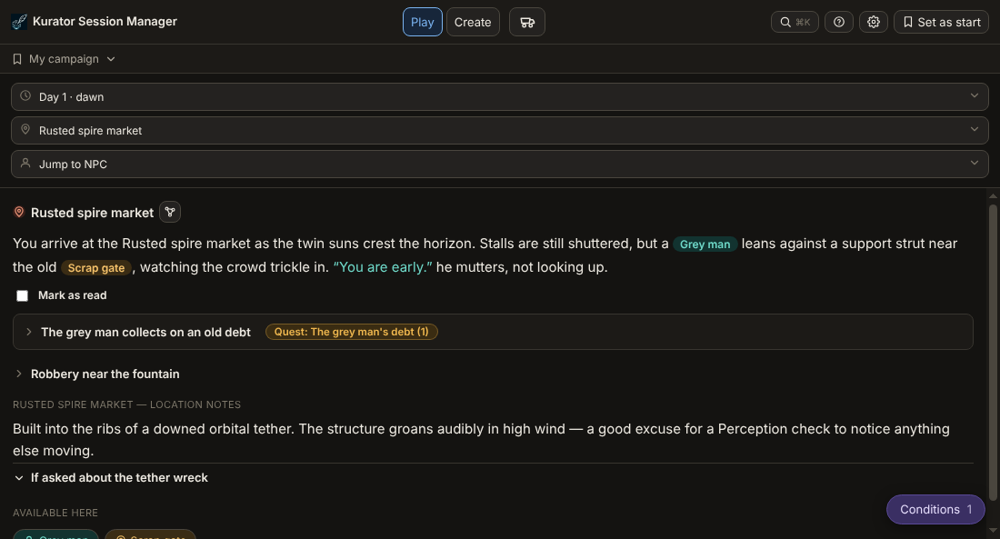</p>

**Available here** lists only the people flagged present at this exact moment. Click or hover any chip, mention or quote to open a quick card.

<p align="center"></p>

NPC cards open inline, accordion style, without leaving the scene. They show the profile, the quick stats, always-visible notes first, then time-specific notes and the **dialogue topics** (collapsible, each one tickable). Open the full page for focused reading.

<p align="center"></p>

### Dice checks and conditions

A **DC check** is a reusable object you drop into any text. In Play it is a button: click it, log the number that was rolled, and Kurator reveals the right result.

- **Scale checks** reveal tiers as the roll rises (DC 10 shows the first line, DC 15 adds the next).
- **Pass/fail checks** use one shared DC with ordered outcomes: success, failure, natural 1, natural 20, and "the 2nd time it failed".
- A check can contain other checks, and the roll log is kept until you reset it.

<p align="center">
  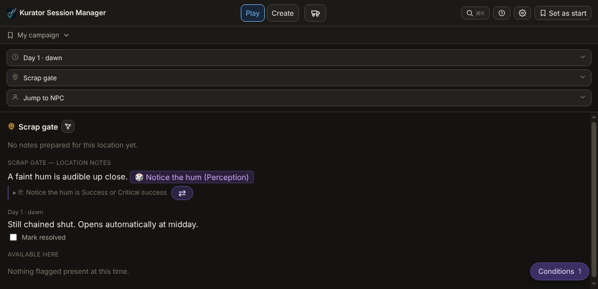
  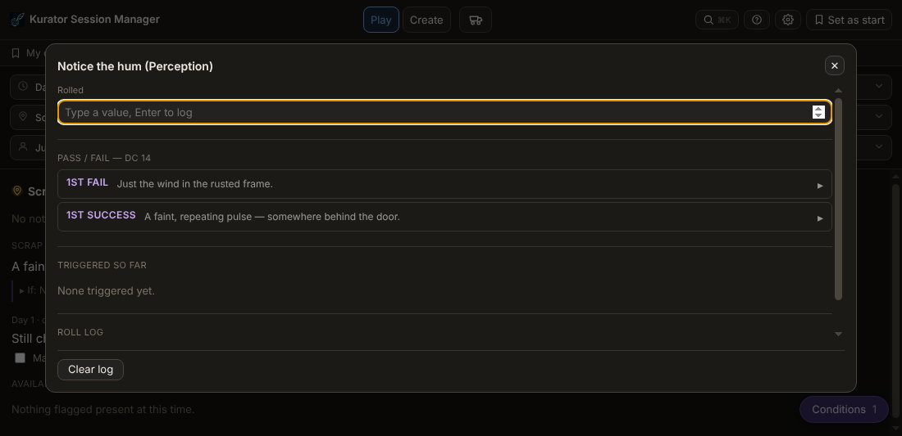
</p>

**Conditions** are named switches or dice results (a check result is one automatically). Any text can be made conditional ("show only when the hum was noticed"), and the **Conditions** dock at the bottom right shows every condition in play and resets them all for a new session.

<p align="center">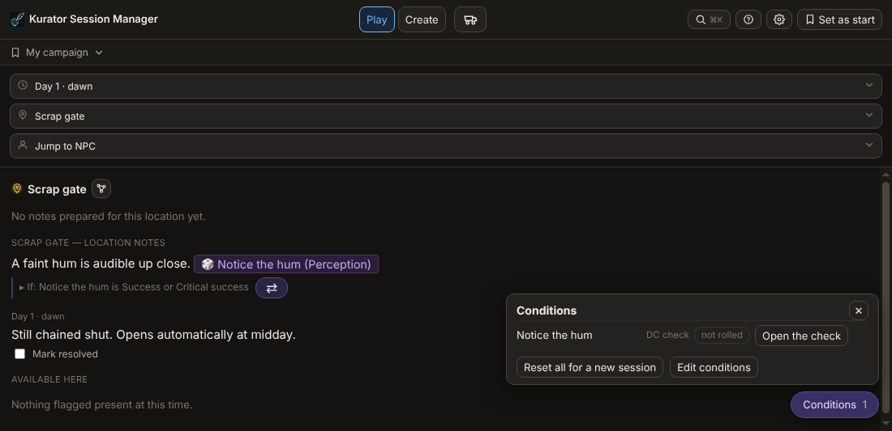</p>

### Jumping around

`Ctrl/Cmd+K` opens the quick jump to any location or NPC. Press it again to switch to **content search**, which finds text inside descriptions, scenes, sections, notes and topics and takes you to the exact spot. `Ctrl/Cmd +` and `-` step through the milestones.

<p align="center">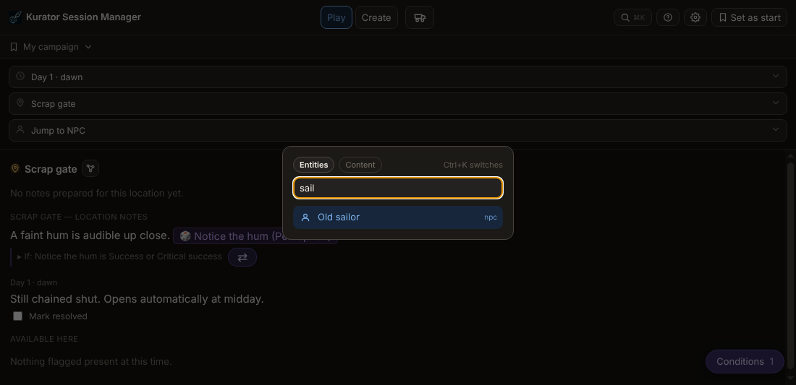</p>

---

## Create mode

### Entities

The **Entities** tab is the list of every NPC, location and quest. Organise them into **groups and subgroups**, search by name or summary, bulk-add many names at once, or **import content** by pasting an outline from Notion (toggles, quotes and headings become structure; page mentions are matched to existing entities).

<p align="center"></p>

**Manage groups** turns the list into a drag-and-drop tree. Every nesting level has its own colour. Select several entities (Click, Ctrl-click, Shift-click) and drag them into a group in one go.

<p align="center"></p>

### The entity editor

Each entity has a name, summary, icon and colour, a group, an optional Notion link and an optional Kodex link. NPCs have a profile (race, age, appearance, history, and so on), a **character card** with a 2024 (5.5e) style **stat block**, voice and personality notes, an inventory table and a loot table. Locations can point at a Director scene or layout. Entities can have a small cropped image, and a default artwork folder is searched for a file that matches the name (forgiving about spaces, dashes and case).

<p align="center">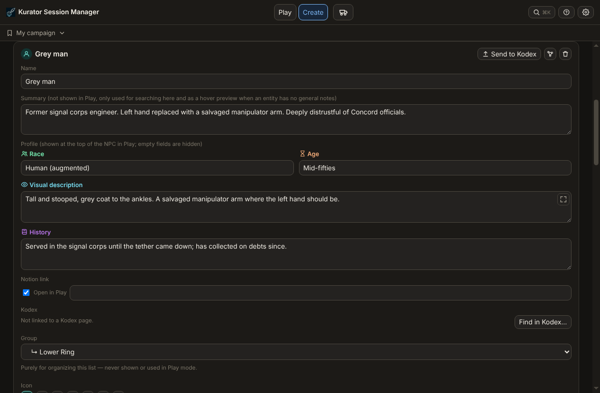</p>

<p align="center"></p>

Long fields have a full-screen button. The stat block has its own editor with the usual 5e layout (abilities, saves, skills with proficiency and expertise).

<p align="center">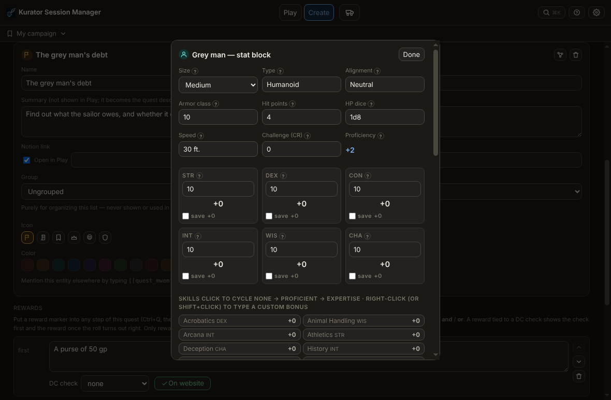</p>

### Scenes and places

Pick a **location and a milestone** and author everything that happens there: the read-aloud description, who is present, trackable sections ("beats") and linear scenes. Type `@` to mention someone, `""` to start a line of dialogue and pick the speaker. Dialogue lines are tinted with the speaker's colour, and a whole scene is one tickable unit. A live **preview** shows how it will look in Play.

<p align="center"></p>

### Library

Every content module in the campaign in one searchable list, filterable by type and by who it is assigned to. Content can be assigned to more than one entity, moved, or reused with **From library…**.

<p align="center"></p>

### Graph

The **Content Graph** shows the campaign as cards and lines: entities, content, milestones, quests and who is present where. It is a pure view over your data (the only thing it stores is card positions). Drag from a card's dot to an entity to connect it, click the dot on a line to set when the connection applies, double-click empty space to create content, and `Ctrl+Z` / `Ctrl+Y` for undo and redo.

<p align="center">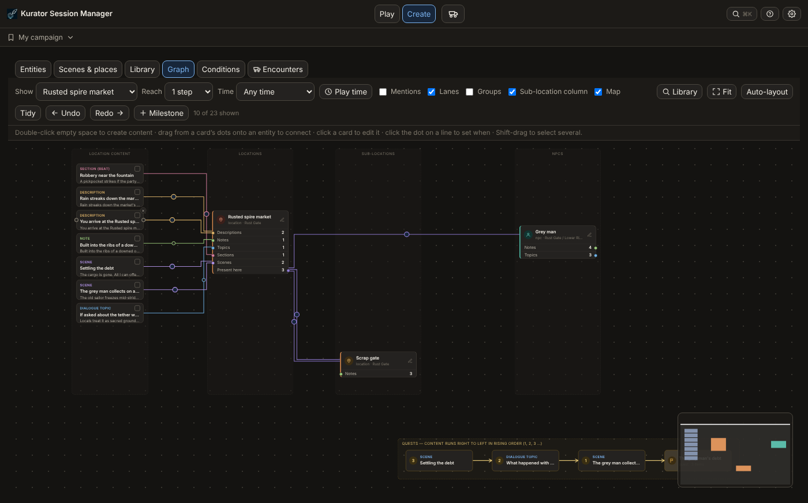</p>

### Conditions and DC checks

The **Conditions** tab lists every condition and every DC check with where it is used. Checks are edited in a pop-up (`Alt+D` inside any text field inserts one, or opens the one under the cursor).

<p align="center"></p>

---

## Quests

A quest is an entity of its own (shown in yellow). Any content block can be **tagged to a quest** and gets a position inside it (step 1, 2, 3, …); moving or removing a block renumbers the rest. The quest page and the quest lane in the graph are derived from these tags, so there is nothing to keep in sync.

Quests can have **rewards** (joined with "and"/"or", optionally tied to a DC check) that you drop into the text of a step with `Ctrl+Q`, and a quest can be **exported for a players' quest website** (objective, clue, NPCs and location per step).

<p align="center"></p>

---

## Travel encounters

The wagon button next to Create opens **travel encounters**: random or chosen events on a journey, kept separate from your normal places so they never clutter the campaign.

- An **encounter** is a place-like entity with its own description, sections, notes, scenes, stat blocks and "present here" list, but no milestones.
- A **collection** is a table of encounters for one journey, with a route (from, via, to, note). The die follows the number of entries (none, exact, grouped ranges, or "reroll 22 to 100").
- In Play, pick a collection, **Start** the journey, roll, and open the result. Used encounters are greyed out and a journey log keeps track. You can always override the roll by clicking another row.

<p align="center">
  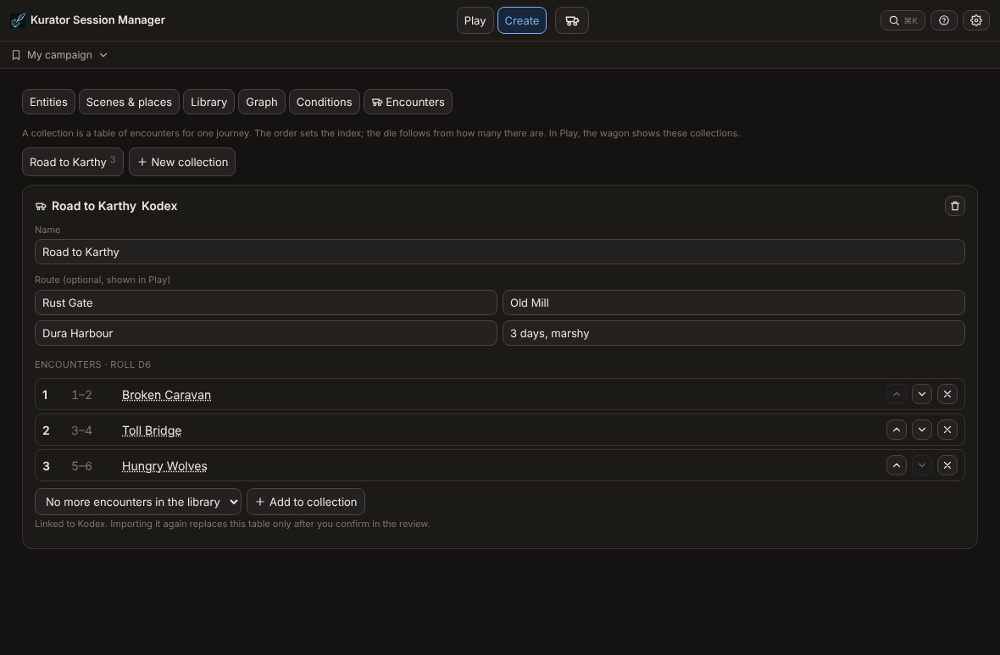
  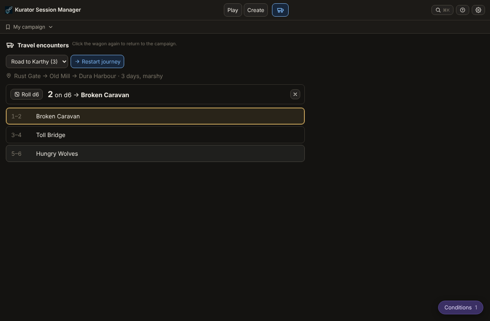
</p>

---

## Astratera Kodex integration

Astratera Kodex is the companion lore tool. Kurator and Kodex exchange content in both directions through a small, versioned export package, using a **three-way merge**: Kurator remembers what each side looked like at the last transfer, so a change on only one side flows through, and a change on both sides is shown as a conflict that you decide. **Nothing is overwritten or deleted silently.**

<p align="center">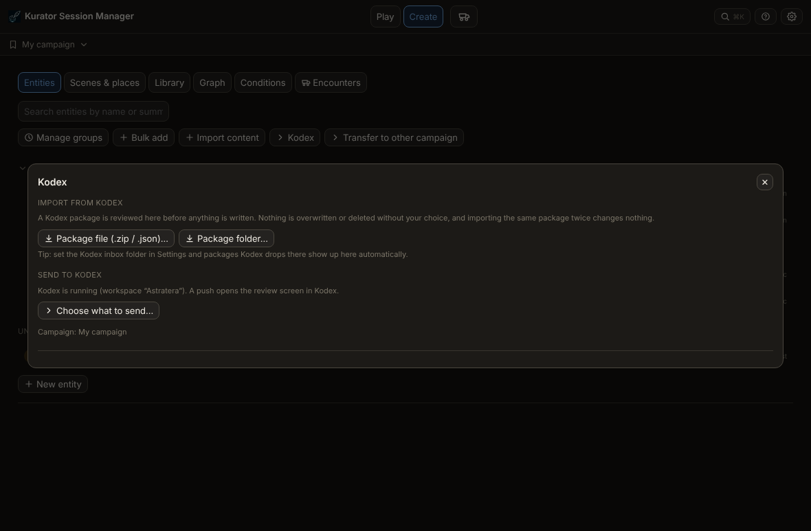</p>

### Import (Kodex → Kurator)

Packages arrive as a file, from a watched inbox folder, or pushed live from the running Kodex. Every package passes through a **review screen** that shows, per entity and per field, what Kurator holds now and what Kodex sent, with a status (new, changed in Kodex, changed in Kurator, same, conflict) and a choice (Take Kodex, Keep Kurator, Keep both, Skip). A backup is taken first.

<p align="center"></p>

What comes across: summaries, profile fields, stat blocks, notes, dialogue topics (including **dialog sections with a speaker**, which are assigned to the speaking NPC), sections, descriptions, "present here", milestones, DC checks, images, and travel encounters with their collections.

### Send (Kurator → Kodex)

Send one entity from the **Send to Kodex** button in its editor, or open the send window to choose many. It has search, filters (type, status), sorting, grouping by your entity groups (with their level colours) and multi-select with Shift-click ranges and Ctrl/Cmd-click for "only this one". Only what changed since the last transfer is offered by default. If Kodex is running the package is pushed and Kodex shows its own review; otherwise save it as a file.

<p align="center">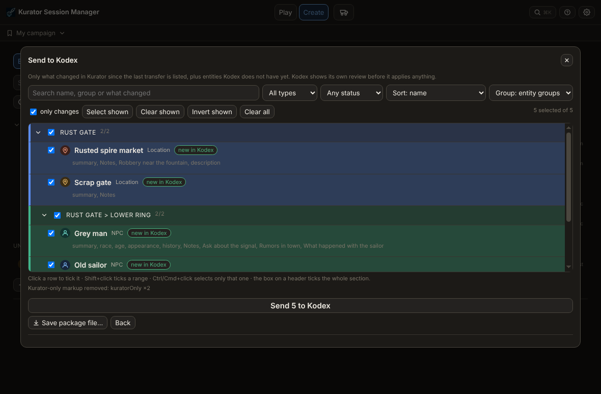</p>

### Open in Kodex

Each entity can be linked to a Kodex page. **Find in Kodex…** searches the entity's name first and offers the match, filtered to the right type (NPC, location, encounter). It reads the live Kodex when it is running and the workspace folder when it is not. Once linked, **Open in Kodex** jumps straight to the page, and a checkbox decides whether it also opens automatically when you open the entity in Play (the same checkbox exists for the Notion link).

<p align="center"></p>

---

## Campaigns, backups and moving content

- **Multiple campaigns** live side by side. Switch, create, rename, **duplicate** or delete them from the campaign menu.
- **Autosave** while you type. Each campaign is one human-readable `campaign.json`, so you can open it in a text editor even if something goes wrong. Entity images are plain files next to it.
- **Backups** are timestamped snapshots in each campaign's `backups` folder (the newest 40 are kept), and an extra snapshot is taken before every import or transfer.
- **Transfer to other campaign** copies NPCs and locations, with everything assigned to them (notes, topics, sections, scenes, inventory, character card, image), into one or more other campaigns. The source campaign is not changed.

<p align="center">
  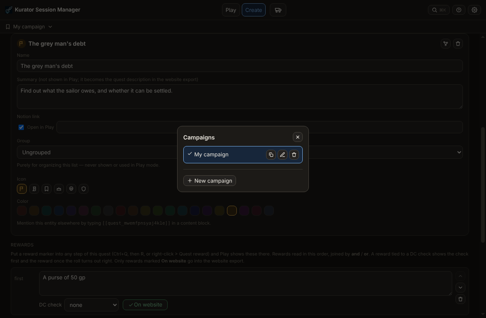
  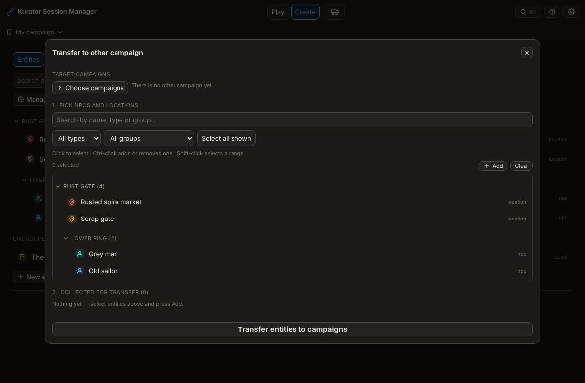
</p>

---

## Other integrations

- **Notion.** A Notion link on an NPC or location opens in your installed Notion app when you open that entity in Play (switch it off per entity with the checkbox without losing the link). Pasted Notion outlines can be imported as content.
- **Director tool.** Optional integration with a separate scene-and-sound tool: pick a scene or layout on a location, and insert buttons with `Alt+S` that switch scene, start music, trigger quickfire sound effects or light scenes. Set the two folders in Settings.

---

## Keyboard shortcuts

Right-click inside any text field for a menu with every insert and formatting option. The full list is in the app (the `?` button).

<p align="center">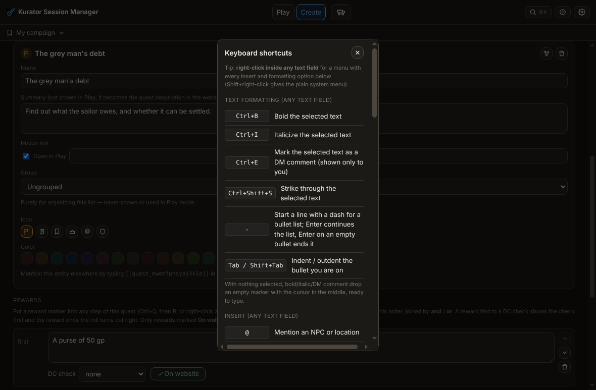</p>

| Where | Keys | What it does |
|---|---|---|
| Text | `Ctrl+B` / `Ctrl+I` / `Ctrl+Shift+S` | Bold, italic, strike through |
| Text | `Ctrl+E` | Mark as DM comment (only you see it) |
| Text | `@` | Mention an NPC or location |
| Text | `""` | Dialogue line, then pick the speaker |
| Text | `Ctrl+L` | Link to a section, topic, scene, description, NPC or location |
| Text | `Alt+D` | Insert or open a DC check |
| Text | `Alt+S` | Insert a tool button (Director, Notion) |
| Text | `Ctrl+Q` | Quest tools (rewards) |
| Anywhere | `Ctrl/Cmd+K` | Jump to an entity, press again for content search |
| Anywhere | `Ctrl/Cmd +` / `-` | Next / previous milestone |
| Play | `Shift+L` | Show the location's loot table |
| Graph | `Shift`-drag, `Delete`, `Ctrl+Z/Y`, `Ctrl+A` | Select, remove from graph, undo / redo, select all |

---

## Install and run

**Requirements:** Node.js (LTS). Kurator is built with Electron and developed and used on Windows; other platforms are untested.

```bash
npm install
npm start          # on Windows you can also use start.bat
```

**Where your data lives.** When run from source, your campaigns are in `campaign-data/` and your settings in `settings.json`, both in the project folder. A packaged portable `.exe` keeps them next to the executable. Set `KURATOR_DATA_DIR` to put them anywhere else (a shared drive, for example). Keep these two out of version control if you work from a clone: they are your campaign, not part of the app.

An example campaign is created on first launch, and a copy of it is in `examples/` so you can browse it on GitHub or drop it in by hand.

**First-run setup (all optional)** is under the gear icon:

- the Director tool folders,
- the Notion app location (the default install path is used automatically),
- the Kodex inbox folder and, for the Kodex picker while Kodex is closed, the Kodex workspace folder (filled in automatically while Kodex runs).

---

## Project layout and development

```
main.js             Electron main process (windows, files, IPC, Kodex API)
preload.js          the bridge exposed to the interface
renderer/           the interface (plain JavaScript, no build step)
src/                data logic shared by the app and the tests (pure Node, no Electron)
  dataModel.js      entities, content, milestones, groups
  query.js          what Play shows for a place and a moment
  kodexSync.js      the three-way merge with Kodex
  kodexBridge.js    package files, inbox, local API, discovery
  encounters.js     travel encounters and collections
  conditions.js     conditions and DC checks
  quests.js         quest tags, rewards, website export
  transfer.js       copying content between campaigns
test/               automated tests (plain Node scripts) and fixtures
scripts/            helper scripts (example campaign generator)
docs/               documentation and screenshots
```

Shared logic in `src/` is concatenated into `renderer/vendor-bundle.js` by `src/copyVendor.js`, so the interface and the tests run exactly the same code. Regenerate the bundle after changing anything in `src/`. The development notes in `docs/DEVELOPMENT-NOTES.md` describe the history and the reasoning behind each feature.

---

## Licence

See `LICENSE` and `NOTICE.md`.
