<p align="center">
  
</p>

<h1 align="center">Astratera Kurator</h1>

<p align="center">
  A session helper for game masters running a long campaign with a lot of prep.<br>
  Write your places, people, scenes and dialogue once, then run the session from one compact, dark window.
</p>

---

Kurator is for game masters who prepare in a notes tool (Notion, or Astratera Kodex) and want something quicker than a wiki **while the game is running**. For the place and the moment you are in, it shows you the text to read aloud, who is there, which plot threads are open and which dice checks might come up. Nothing else gets in the way.

It was written for a sci-fi D&D campaign, but nothing in it belongs to one setting. Everything stays on your own computer, in ordinary files you can open yourself. No account, no cloud.

All screenshots in this document use the small example campaign that comes with the app.

## Contents

- [How it works, in one minute](#how-it-works-in-one-minute)
- [Play mode](#play-mode)
- [Create mode](#create-mode)
- [Quests](#quests)
- [Travel encounters](#travel-encounters)
- [Working with Astratera Kodex](#working-with-astratera-kodex)
- [Several campaigns, backups and copying content](#several-campaigns-backups-and-copying-content)
- [Notion and the Director tool](#notion-and-the-director-tool)
- [Keyboard shortcuts](#keyboard-shortcuts)
- [Install and run](#install-and-run)
- [For developers](#for-developers)

---

## How it works, in one minute

You write your prep as small pieces: a place description, a note about someone, a dialogue topic, a short checklist item, a scripted scene. Each piece belongs to a **person, a place or a quest**, and can be tied to a **moment in your story**.

- **Moments in time.** Instead of fixed chapters, you create your own list of moments ("Day 1 · dawn", "After the heist") and move along it as the story goes on. Use as many or as few as you like.
- **Who is there.** For every place and moment you mark which people are present. That is what the "Available here" list shows while you play.
- **Mentions.** In any text, type `@` and a name to turn it into a clickable chip. The person does not have to be present for the chip to work, so you can always get to them quickly.
- **Nothing is ever lost while you play.** Ticking something off only hides it from later screens, and unticking brings it back. Anything you did not finish **follows you** to the next moment. That means you can click back and forth through the timeline to test a session without breaking anything.
- **No gaps.** If you open a place at a moment where you wrote nothing, Kurator shows the most recent earlier notes and tells you so.

The two main modes are at the top of the window: **Play** (run the session) and **Create** (write and organise your prep).

---

## Play mode

Pick a moment and a place and the text to read aloud appears. It reads as one piece, with no checkboxes in the middle of it. Names are coloured chips you can click. Short checklist items appear underneath. A counter and an **Undo all since start** button let you rehearse a session and then roll everything back with one click (use **Set as start** to mark where you began).

<p align="center"></p>

**Available here** lists only the people who are present at this place at this moment. Hover over or click any name to see a quick card.

<p align="center">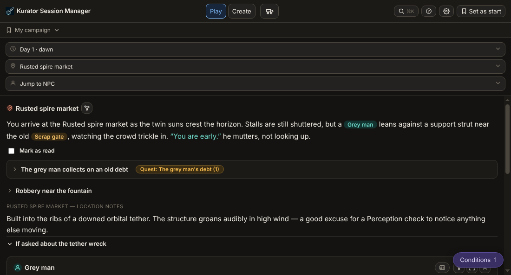</p>

A character card opens right inside the scene, so you never lose your place. It shows the profile, the quick numbers you need (like passive Perception), your notes, and the **dialogue topics**: little collapsible questions the players might ask, which you can tick off as they come up. Open the full page if you want to read more in peace.

<p align="center">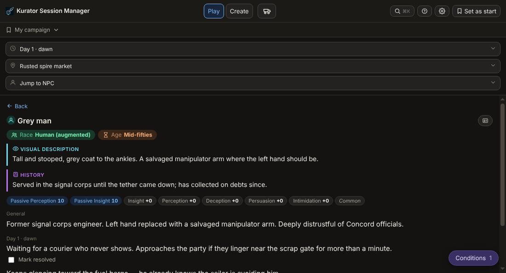</p>

### Dice checks and conditions

A **DC check** is a ready-made skill check you can put into any text. During play it shows up as a button. Click it, type in what was rolled, and Kurator shows you what the players learn.

- **Tiered checks** reveal more the higher the roll is (a 10 shows the first clue, a 15 adds the next).
- **Pass or fail checks** have one target number and different outcomes for success, failure, a natural 1, a natural 20, and even "the second time they fail".
- A check can contain other checks, and its roll history stays until you reset it.

<p align="center">
  
  
</p>

**Conditions** are simple switches that remember what has happened ("the hum was noticed", "the gate is open"). The result of a DC check is one automatically. You can make any piece of text appear only when a condition is met. The **Conditions** button at the bottom right lists everything that is switched on, and resets it all for a new session.

<p align="center"></p>

### Getting around fast

Press `Ctrl/Cmd+K` to jump to any place or person. Press it again to search the **text itself**: descriptions, scenes, notes and dialogue topics. Pick a result and Kurator takes you straight to that passage. `Ctrl/Cmd +` and `-` move to the next or previous moment in your story.

<p align="center"></p>

---

## Create mode

### People, places and quests

The **Entities** tab is your list of everything: NPCs, locations and quests. Sort them into **groups and subgroups**, search by name, add many names at once, or **import your prep from Notion** by pasting it in (headings, toggles and quotes become structure, and names are matched to people you already have).

<p align="center">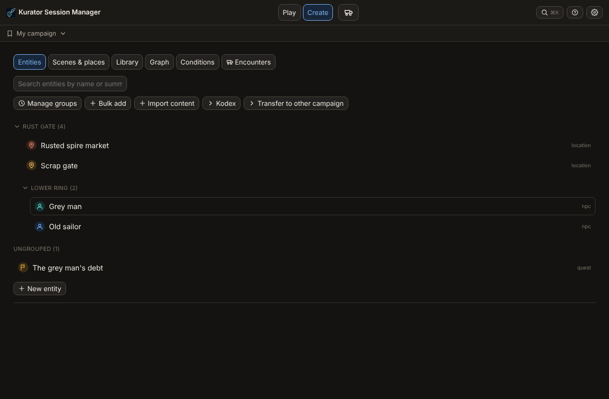</p>

**Manage groups** turns the list into a tree you can rearrange by dragging. Each level of groups has its own colour. Select several entries (click, Ctrl-click, Shift-click) and drag them into a group in one go.

<p align="center">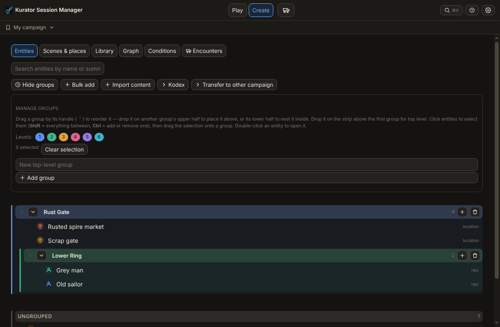</p>

### The editor for a person or place

Every entry has a name, a short summary, an icon and a colour, a group, and optionally a link to its Notion page and to its Kodex page. NPCs also get a profile (race, age, looks, history and so on), a **character sheet** with a stat block in the current 5.5e style, notes on voice and personality, an item list and a loot table. Places can point to a scene in the Director tool. You can add a small cropped picture, and Kurator can find a matching image in your artwork folder by name (it does not mind spaces, dashes or capital letters).

<p align="center"></p>

<p align="center">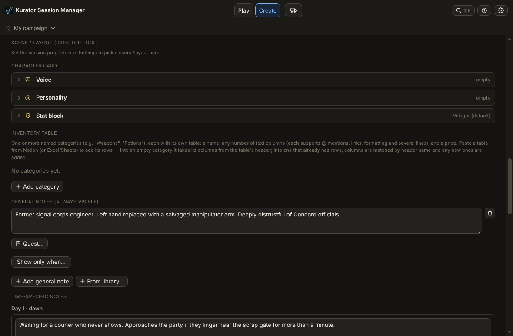</p>

Long text fields have a full-screen button. The stat block has its own editor with the familiar layout: ability scores, saving throws and skills with proficiency and expertise.

<p align="center"></p>

### Scenes and places

Choose a **place and a moment** and write everything that happens there: the text to read aloud, who is present, checklist items and scripted scenes. Type `@` to mention someone. Type `""` to start a line of dialogue and pick who says it. Each speaker gets their own colour, and a whole scene is ticked off as one. A live **preview** shows exactly how it will look in Play mode.

<p align="center">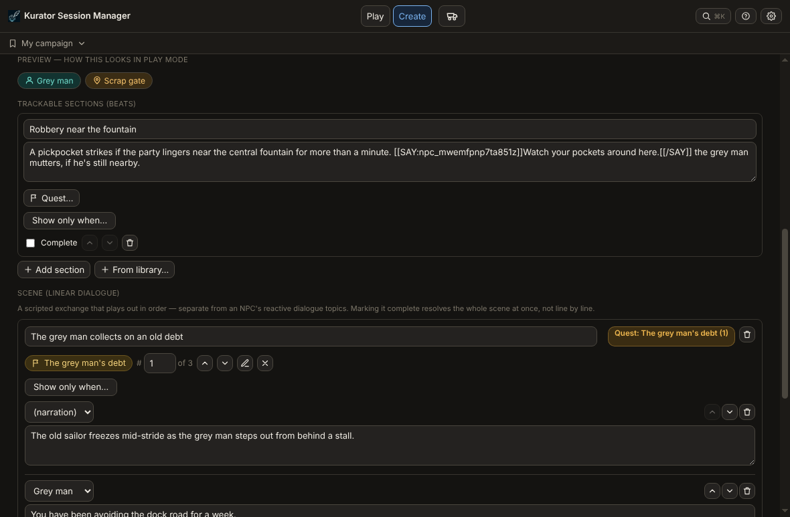</p>

### Library

Everything you have written, in one searchable list, which you can filter by type or by whose it is. A piece can belong to more than one person, can be moved, and can be reused with **From library…**.

<p align="center">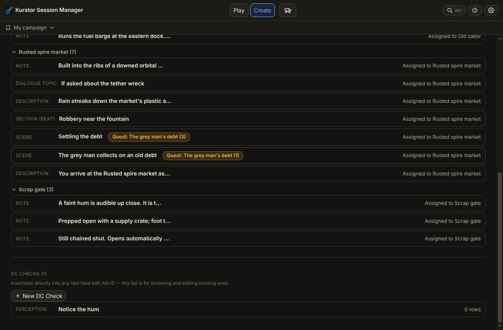</p>

### Graph

The **graph** is a map of your campaign: people, places, notes, moments, quests and who is where, drawn as cards joined by lines. It is only a picture of what you have already written, so it never gets out of date. Drag from a dot on a card to a person to connect them, click the dot on a line to say when the connection applies, double-click on empty space to write something new, and use `Ctrl+Z` / `Ctrl+Y` to undo or redo.

<p align="center"></p>

### Conditions and DC checks

The **Conditions** tab lists every condition and every DC check and shows where each one is used. You edit a check in its own window. Pressing `Alt+D` in any text field adds a check, or opens the one your cursor is in.

<p align="center">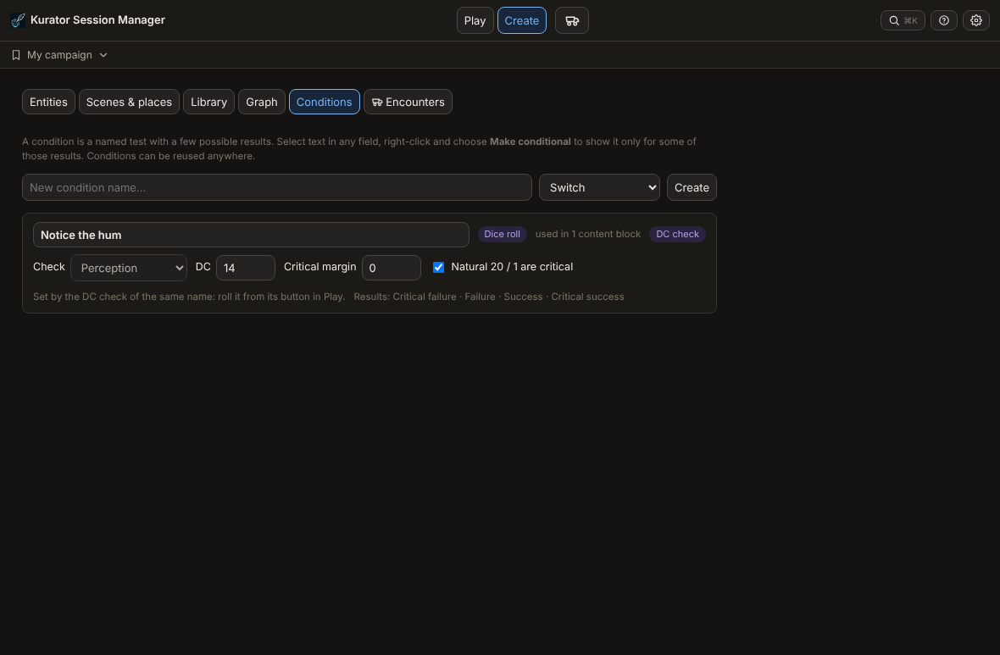</p>

---

## Quests

A quest is its own entry (shown in yellow). You can **tag any piece of text as a step of a quest**. Steps are numbered automatically, and moving or removing one renumbers the rest. The quest page and the quest row in the graph are built from these tags, so there is nothing extra to keep up to date.

Quests can have **rewards**, joined with "and" or "or" and optionally tied to a DC check. Add one to a step with `Ctrl+Q`. A quest can also be **exported for a quest website** for your players (the goal, the clue, the people and the place for each step).

<p align="center">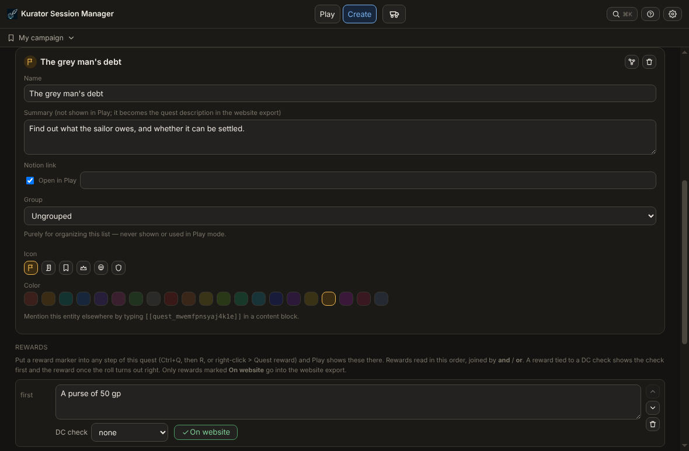</p>

---

## Travel encounters

The wagon button next to Create opens **travel encounters**: events that can happen on a journey. They are kept apart from your normal places so they do not clutter the campaign.

- An **encounter** works like a place, with its own text, checklist items, scenes, stat blocks and "who is here", but without a timeline.
- A **collection** is a table of encounters for one journey, with the route (from, via, to, notes). Kurator works out the right die for the number of entries: a plain d6, grouped ranges, or "reroll 22 to 100".
- In Play mode, choose a collection, press **Start**, roll, and open the result. Encounters you have used are greyed out, and a journey log keeps track. You can always click another row to override the roll.

<p align="center">
  
  
</p>

---

## Working with Astratera Kodex

Astratera Kodex is a companion tool for your world lore. Kurator and Kodex can send content to each other in both directions. Kurator remembers what both sides looked like the last time they were in sync, so it knows who changed what. A change on only one side simply goes through. A change on both sides is shown to you as a **conflict**, and you decide. **Nothing is ever overwritten or deleted behind your back.**

<p align="center"></p>

### Getting content from Kodex

Content from Kodex arrives as a file, through an inbox folder that Kurator keeps an eye on, or sent directly from the running Kodex. Before anything is changed, you see a **review screen** that shows, for each person and each field, what Kurator has now and what Kodex sent. A label tells you what happened (new, changed in Kodex, changed in Kurator, same, conflict), and you choose: take Kodex's version, keep yours, keep both, or skip. A backup is made first.

<p align="center">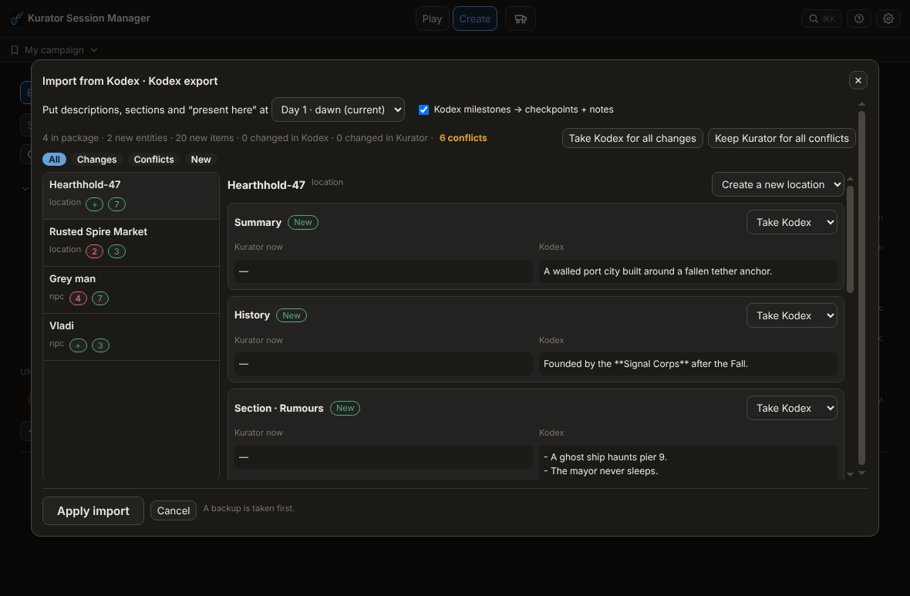</p>

What can come across: summaries, profile details, stat blocks, notes, dialogue topics (including dialogue with a named speaker, which is attached to the NPC who says it), sections, place descriptions, who is present, story moments, DC checks, pictures, and travel encounters with their collections.

### Sending content to Kodex

To send one entry, use the **Send to Kodex** button at the top of its editor. To send many, open the send window. It has search, filters (by type and by status), sorting, grouping by your own groups (in their level colours), and easy multi-select: click to tick, Shift-click for a range, Ctrl/Cmd-click to pick only one. By default only things that changed since the last send are listed. If Kodex is running, the content goes straight into it and Kodex shows its own review. If not, save it as a file and import it later.

<p align="center"></p>

### Open in Kodex

Every person or place can be linked to a page in Kodex. **Find in Kodex…** searches for the entry's name first and suggests the match, limited to the right kind of page (person, place or encounter). It works while Kodex is running and also while it is closed. Once linked, **Open in Kodex** takes you straight to that page. A checkbox decides whether the page also opens by itself when you open that entry in Play mode. The Notion link has the same checkbox.

<p align="center">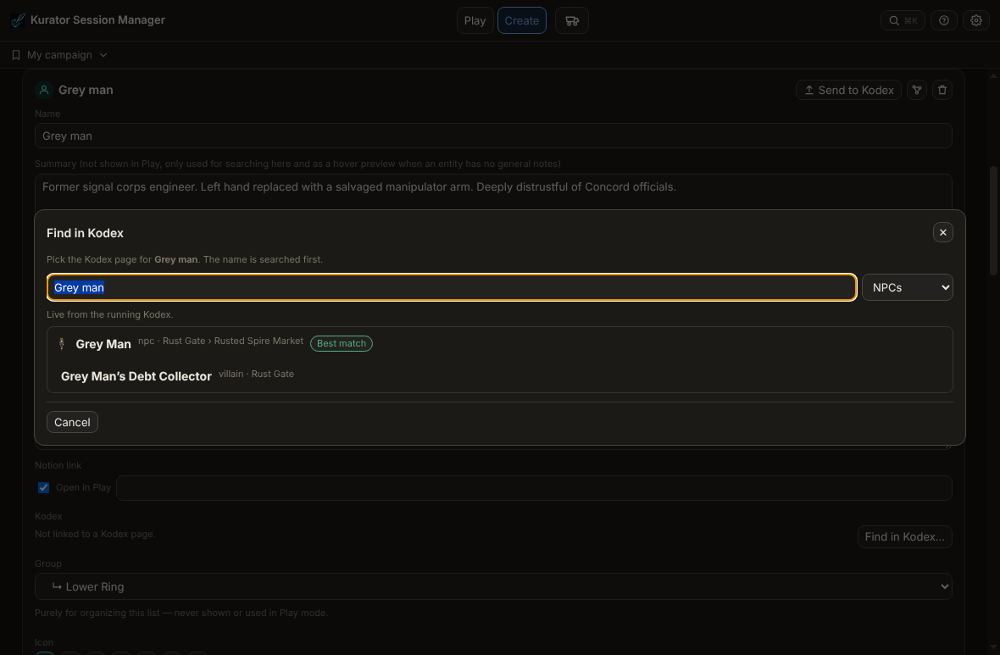</p>

---

## Several campaigns, backups and copying content

- **Several campaigns** can live side by side. Switch, create, rename, **duplicate** or delete them from the campaign menu.
- **Saving is automatic** while you type. Each campaign is kept as one readable file, so you can still open it in a text editor if something ever goes wrong. Pictures are normal image files next to it.
- **Backups** are saved automatically (the newest 40 are kept). A fresh backup is also made before every import and every copy to another campaign.
- **Transfer to other campaign** copies people and places, with all their notes, topics, scenes, items, character sheets and pictures, into one or more other campaigns. The campaign you copy from stays unchanged.

<p align="center">
  
  
</p>

---

## Notion and the Director tool

- **Notion.** If a person or place has a Notion link, the page opens in your Notion app when you open that entry in Play mode. A checkbox lets you switch this off for one entry without deleting the link. You can also paste your Notion prep to import it as content.
- **Director tool.** If you use the separate Director tool for scenes and sound, Kurator can pick a scene for a place and add buttons to your text with `Alt+S`: switch scene, start music, play quick sound effects or change the lighting. Tell Kurator where the Director folders are in Settings.

---

## Keyboard shortcuts

Right-click in any text field to see every formatting and insert option in a menu. The complete list is in the app behind the `?` button.

<p align="center"></p>

| Where | Keys | What it does |
|---|---|---|
| Text | `Ctrl+B` / `Ctrl+I` / `Ctrl+Shift+S` | Bold, italic, strikethrough |
| Text | `Ctrl+E` | Mark a passage as a note to yourself (only you can see it) |
| Text | `@` | Mention a person or place |
| Text | `""` | Start a line of dialogue, then pick who says it |
| Text | `Ctrl+L` | Link to a section, topic, scene, person or place |
| Text | `Alt+D` | Add a DC check (or open the one under your cursor) |
| Text | `Alt+S` | Add a tool button (Director, Notion) |
| Text | `Ctrl+Q` | Quest tools (rewards) |
| Anywhere | `Ctrl/Cmd+K` | Jump to a person or place; press again to search the text |
| Anywhere | `Ctrl/Cmd +` / `-` | Next / previous moment in your story |
| Play | `Shift+L` | Show the loot table of the current place |
| Graph | `Shift`-drag, `Delete`, `Ctrl+Z/Y`, `Ctrl+A` | Select several cards, remove from graph, undo / redo, select all |

---

## Install and run

You need [Node.js](https://nodejs.org) (the LTS version). Kurator is built with Electron and is developed and used on Windows. Other systems have not been tested.

1. Download or clone this repository.
2. Open a terminal in the folder and run `npm install` once.
3. Start the app with `npm start`. On Windows you can also double-click `start.bat`.

**Where your campaigns are saved.** When you run from the project folder, your campaigns are in a folder called `campaign-data` and your settings in `settings.json`, both inside the project folder. A packaged portable `.exe` keeps them next to the `.exe`. If you work from a clone of this repository, keep these two out of version control: they are your campaign, not part of the app. You can move them elsewhere (a shared drive, for example) by setting `KURATOR_DATA_DIR`.

The first time you start Kurator, a small example campaign is created so you can look around. A copy is in the `examples` folder as well.

**Settings (all optional)** are behind the gear icon:

- the folders of the Director tool,
- the location of the Notion app (the normal install location is found automatically),
- the Kodex inbox folder and, so that "Find in Kodex" also works while Kodex is closed, the Kodex workspace folder (filled in by itself whenever Kodex is running).

---

## For developers

```
main.js             the Electron main process (windows, files, communication with Kodex)
preload.js          the bridge between the main process and the interface
renderer/           the interface (plain JavaScript, no build step)
src/                the logic shared by the app and the tests (plain Node, no Electron)
  dataModel.js      people, places, content, moments in time, groups
  query.js          what Play mode shows for a place and a moment
  kodexSync.js      the merge with Kodex
  kodexBridge.js    package files, inbox, the local connection to Kodex
  encounters.js     travel encounters and collections
  conditions.js     conditions and DC checks
  quests.js         quest tags, rewards, website export
  transfer.js       copying content between campaigns
test/               automated tests (plain Node scripts) and sample files
scripts/            helper scripts (generates the example campaign)
docs/               documentation and screenshots
```

The logic in `src/` is bundled into `renderer/vendor-bundle.js` by `src/copyVendor.js`, so the interface and the tests run exactly the same code. Regenerate the bundle after changing anything in `src/`. `docs/DEVELOPMENT-NOTES.md` describes the history of each feature and the reasoning behind it.

---

## Licence

See `LICENSE` and `NOTICE.md`.
